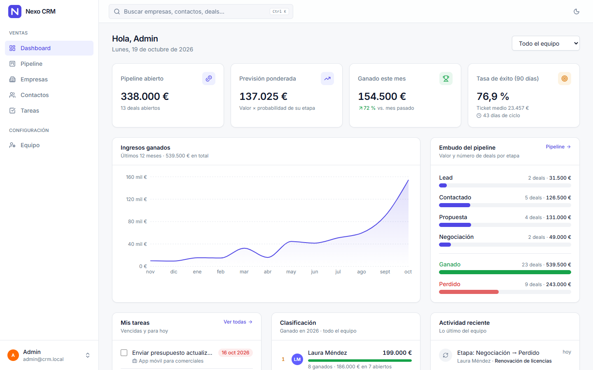
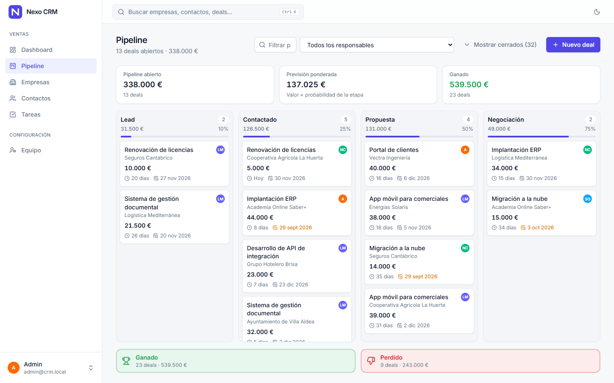
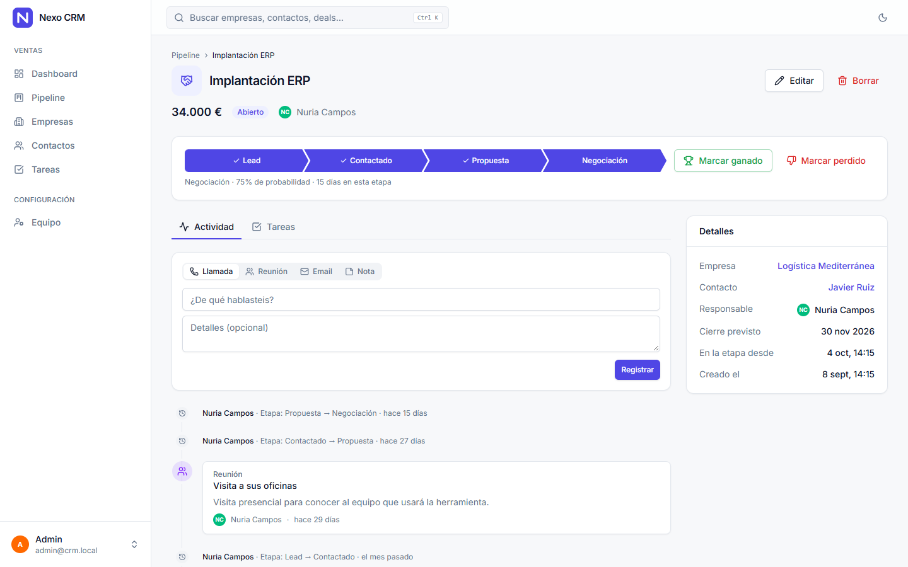
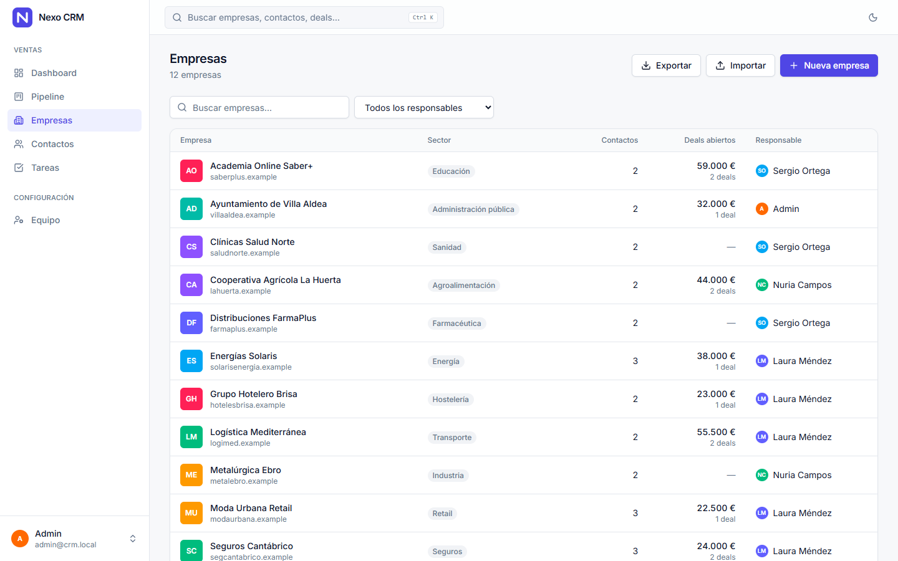
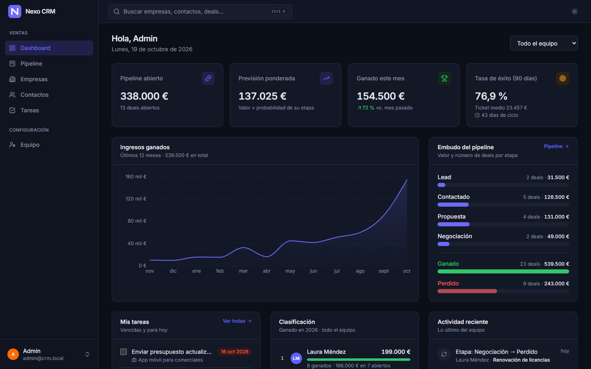
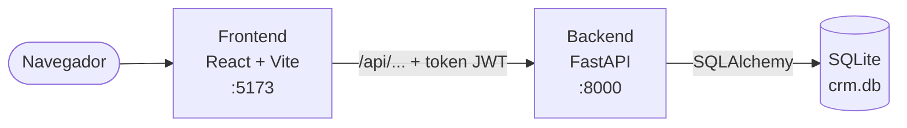
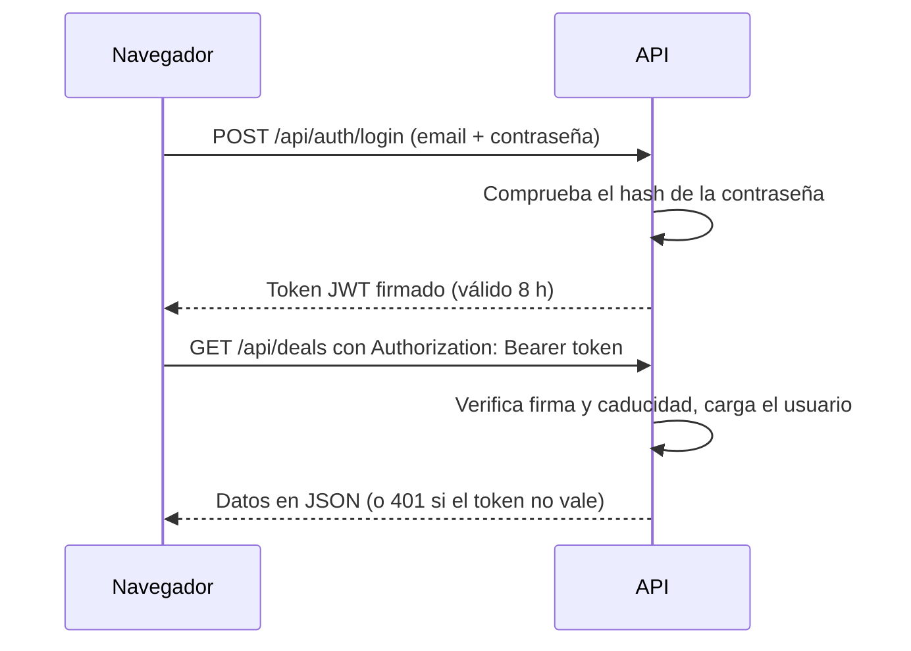
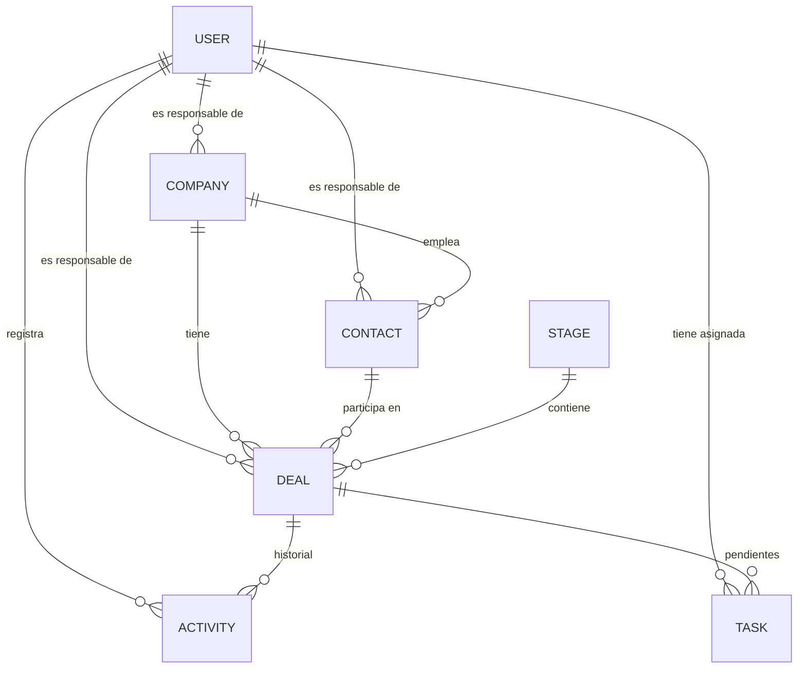

# Nexo CRM

CRM de ventas B2B construido desde cero para entender cómo funciona por dentro
un CRM: empresas, contactos, oportunidades en un pipeline Kanban, historial de
actividad, tareas, métricas de ventas y un equipo de vendedores con roles.




> **Proyecto de aprendizaje.** Está pensado para ejecutarse en local. Las
> contraseñas de ejemplo son públicas y la configuración no está preparada para
> desplegarse en internet tal cual (ver [Seguridad](#seguridad)).

## Índice

- [Qué es un CRM](#qué-es-un-crm)
- [Funcionalidades](#funcionalidades)
- [Capturas](#capturas)
- [Arquitectura](#arquitectura)
- [Modelo de datos](#modelo-de-datos)
- [Puesta en marcha](#puesta-en-marcha)
- [Tests y migraciones](#tests-y-migraciones)
- [API](#api)
- [Estructura del proyecto](#estructura-del-proyecto)
- [Seguridad](#seguridad)
- [Cómo se construyó](#cómo-se-construyó)
- [Licencia](#licencia)

## Qué es un CRM

Un CRM (*Customer Relationship Management*) guarda **a quién le vendes**
(empresas y contactos), **qué le intentas vender** (oportunidades o *deals*),
**qué ha pasado** (llamadas, reuniones, emails, notas) y **qué toca hacer**
(tareas). Las oportunidades avanzan por un **pipeline**: un tablero Kanban en
el que cada columna es una etapa de la venta, de "Lead" a "Ganado" o "Perdido".

## Funcionalidades

- **Dashboard**: pipeline abierto, previsión ponderada (importe × probabilidad
  de la etapa), ganado este mes frente al anterior, tasa de éxito, ticket medio,
  ingresos de los últimos 12 meses, embudo por etapa, clasificación de
  vendedores, tareas pendientes y actividad reciente.
- **Pipeline Kanban**: todas las etapas abiertas a la vista; los deals se
  arrastran entre columnas y se sueltan en las zonas *Ganado* / *Perdido* para
  cerrarlos. Cada tarjeta muestra el responsable, los días en la etapa y si la
  fecha de cierre ya pasó.
- **Fichas** de deal, empresa y contacto con historial de actividad y tareas.
  El historial de los deals se completa solo: quién lo creó, quién lo movió de
  etapa o le cambió el responsable.
- **Tareas** con responsable y fecha: vencidas, de hoy, próximas y hechas.
- **Equipo y roles**: inicio de sesión, responsable en cada registro (filtro
  "solo los míos"), administradores que dan de alta usuarios, cambian roles y
  desactivan accesos, y perfil propio con cambio de contraseña.
- **Importar y exportar CSV** de empresas y contactos, con validación previa y
  errores fila por fila antes de guardar nada.
- **Búsqueda global** (Ctrl+K), **modo claro/oscuro** y diseño adaptado a móvil.

## Capturas

| Pipeline | Ficha de un deal |
|---|---|
|  |  |

| Empresas | Modo oscuro |
|---|---|
|  |  |

## Arquitectura

El frontend y el backend son dos aplicaciones separadas que se comunican por
HTTP intercambiando JSON. Cada petición lleva un token JWT que identifica al
usuario.



En desarrollo, Vite hace de *proxy*: el navegador solo habla con `:5173` y Vite
reenvía las peticiones `/api` al backend, así que no hace falta configurar CORS.

| Pieza | Tecnología | Papel |
|---|---|---|
| Frontend | React 19, Vite, React Router, Tailwind CSS 4, Recharts, Lucide | Interfaz: pide los datos a la API y los pinta. |
| Backend | FastAPI, SQLAlchemy 2, Alembic, Pydantic, PyJWT | API REST: autentica, valida, aplica las reglas de negocio y habla con la base de datos. |
| Base de datos | SQLite | Un único fichero (`backend/crm.db`). Pasar a PostgreSQL es cambiar la URL de conexión. |
| Tests | pytest | Pruebas de la API contra una base de datos temporal. |

### Cómo funciona el inicio de sesión



## Modelo de datos



| Tabla | Qué representa |
|---|---|
| `users` | Un vendedor: inicia sesión, puede ser administrador y es responsable de empresas, contactos, deals y tareas. |
| `companies` | Una empresa cliente o potencial cliente. |
| `contacts` | Una persona, normalmente de una empresa. |
| `stages` | Una columna del pipeline, con su probabilidad de cierre. |
| `deals` | Una oportunidad de venta: importe, etapa, responsable y fecha prevista de cierre. |
| `activities` | Algo que **ya pasó**: llamada, reunión, email, nota o un cambio registrado por el sistema. |
| `tasks` | Algo que **hay que hacer**, con responsable y fecha límite. |

Las actividades y las tareas pueden colgar de un deal, de un contacto o de una
empresa. Las etapas por defecto son Lead (10 %), Contactado (25 %), Propuesta
(50 %), Negociación (75 %), Ganado (100 %) y Perdido (0 %).

## Puesta en marcha

### Requisitos

- Python 3.11 o superior
- Node.js 20 o superior

### Backend

```bash
cd backend
python -m venv .venv
```

Activa el entorno virtual:

```bash
# Windows
.venv\Scripts\activate
# macOS / Linux
source .venv/bin/activate
```

Instala las dependencias, carga los datos de ejemplo (opcional) y arranca la API:

```bash
pip install -r requirements-dev.txt
python seed_demo.py
uvicorn app.main:app --reload
```

Al arrancar, el backend aplica las migraciones pendientes y crea las etapas del
pipeline y el usuario administrador si no existen. `seed_demo.py` añade 12
empresas, 30 contactos, 45 deals de los últimos 12 meses y 4 vendedores con su
historial y tareas; solo carga datos si la base de datos no tiene empresas.

### Frontend

En otra terminal:

```bash
cd frontend
npm install
npm run dev
```

| URL | Qué hay |
|---|---|
| http://localhost:5173 | La aplicación |
| http://localhost:8000/docs | Documentación interactiva de la API (Swagger; botón *Authorize* para iniciar sesión) |

### Usuarios de ejemplo

| Email | Contraseña | Rol |
|---|---|---|
| `admin@crm.local` | `admin1234` | Administrador (se crea siempre al arrancar) |
| `laura@crm.local`, `sergio@crm.local`, `nuria@crm.local` | `demo1234` | Vendedor (solo con los datos de ejemplo) |

Para crear más, entra como administrador y ve a **Configuración → Equipo →
Nuevo usuario**.

Los emails y teléfonos de los datos de ejemplo no pertenecen a nadie: los
dominios acaban en `.example` (reservado por el estándar RFC 2606) y los
teléfonos son del rango `555-0100`–`555-0199`, reservado para ficción.

<details>
<summary><strong>Problema conocido en Windows: "An Application Control policy has blocked this file"</strong></summary>

Si Smart App Control está activado, Windows puede bloquear las extensiones
compiladas de SQLAlchemy. Instálalo en su versión de Python puro (funciona
igual). En PowerShell:

```powershell
$env:DISABLE_SQLALCHEMY_CEXT = "1"
pip install --no-binary sqlalchemy --force-reinstall --no-deps sqlalchemy
```

En CMD, la primera línea es `set DISABLE_SQLALCHEMY_CEXT=1`.

</details>

## Tests y migraciones

```bash
cd backend
python -m pytest
```

Los tests usan una base de datos temporal y nunca tocan `crm.db`.

Si cambias un modelo en `backend/app/models.py`, genera y aplica una migración
con Alembic (arrancar el backend también aplica las pendientes):

```bash
alembic revision --autogenerate -m "describe el cambio"
alembic upgrade head
```

## API

La referencia completa (parámetros, forma del JSON y reglas de negocio) está en
[`docs/api.md`](docs/api.md). Todos los endpoints salvo el login exigen un token.

| Recurso | Endpoints |
|---|---|
| Sesión | `POST /api/auth/login`, `GET/PATCH /api/auth/me`, `POST /api/auth/password` |
| Usuarios | `GET/POST /api/users`, `PATCH /api/users/{id}` |
| Dashboard | `GET /api/dashboard` |
| Etapas | `GET /api/stages` |
| Empresas | `GET/POST /api/companies`, `GET/PATCH/DELETE /api/companies/{id}`, `GET /api/companies/export`, `POST /api/companies/import` |
| Contactos | `GET/POST /api/contacts`, `GET/PATCH/DELETE /api/contacts/{id}`, `GET /api/contacts/export`, `POST /api/contacts/import` |
| Deals | `GET/POST /api/deals`, `GET/PATCH/DELETE /api/deals/{id}` |
| Actividades | `GET/POST /api/activities`, `DELETE /api/activities/{id}` |
| Tareas | `GET/POST /api/tasks`, `PATCH/DELETE /api/tasks/{id}` |
| Búsqueda | `GET /api/search?q=` |

## Estructura del proyecto

```
backend/
  app/
    main.py         arranque: migraciones, datos iniciales y routers
    models.py       tablas (modelos de SQLAlchemy)
    schemas.py      forma del JSON que entra y sale (Pydantic)
    security.py     contraseñas cifradas, tokens JWT y permisos
    routers/        endpoints, un fichero por recurso
    crud.py         utilidades comunes (404, validar claves foráneas...)
    csv_io.py       lectura y generación de CSV
  alembic/          migraciones de la base de datos
  tests/            tests con pytest
  seed_demo.py      datos de ejemplo
frontend/
  src/
    App.jsx         rutas (cada página se carga bajo demanda)
    api.js          cliente de la API (añade el token a cada petición)
    auth/           sesión del usuario y rutas protegidas
    components/ui/  sistema de diseño: botones, campos, modales, tablas...
    components/     layout, buscador, historial, lista de tareas
    hooks/          hooks reutilizables (peticiones, debounce, tema...)
    lib/            formato de importes y fechas, utilidades
    pages/          una carpeta por pantalla
docs/
  api.md            contrato de la API
  screenshots/      capturas del README
```

## Seguridad

Lo que ya hace la aplicación:

- Las contraseñas se guardan cifradas con `scrypt` y una sal aleatoria.
- Toda la API exige un token JWT firmado, que caduca a las 8 horas.
- Solo los administradores gestionan el equipo; un usuario desactivado pierde
  el acceso al momento, y un administrador no puede quitarse su propio rol.

Lo que habría que cambiar antes de desplegarla en un servidor público:

- **Clave de firma de los tokens**: definir la variable de entorno
  `CRM_SECRET_KEY` con un valor aleatorio y secreto. La que trae el código por
  defecto es pública, y con ella cualquiera podría fabricar tokens válidos.
- **Usuario administrador**: cambiar la contraseña de `admin@crm.local` en
  cuanto arranque y no cargar los datos de ejemplo.
- Limitar los intentos de inicio de sesión y usar HTTPS.

## Cómo se construyó

El proyecto se hizo por fases, cada una sobre la anterior:

1. **Base**: estructura del backend y el frontend, modelo de datos y conexión
   React ↔ API.
2. **CRM funcional**: empresas, contactos y deals; pipeline Kanban con
   arrastrar y soltar; actividades, tareas y búsqueda.
3. **Producto completo**: inicio de sesión y roles, responsables, historial
   automático, dashboard, importación y exportación CSV, migraciones con
   Alembic, tests y un sistema de diseño propio con modo oscuro.

## Licencia

Distribuido bajo la licencia MIT. Consulta el fichero [LICENSE](LICENSE).
